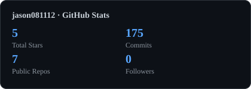
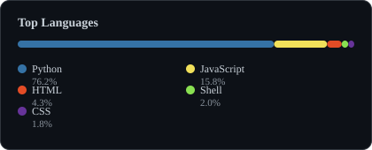

# Hi there, I'm Jason Wang 👋

**Student developer · Building a privacy-first companion AI, games, and tools for education**
学生开发者 · 做隐私优先的陪伴型 AI、游戏，以及赋能教育的技术

---

You could describe me as —

- 🤖 **companion AI builder** — building **Pre_Alpha**, a privacy-first companion AI: distill chat logs into a persona, run the persona engine in the cloud, and expose it through Web/PWA and an OpenAI-compatible API. P0–P3 are complete; the Web interaction layer (P4) is in progress.
- 🎓 **edtech builder** — puts technology and AI behind education: a gaokao essay evaluator that auto-detects **应用文 & 读后续写** and scores against the official rubric, plus an agent skill that distills a writer's style and recreates it in new text
- 🎮 **game maker** — built *Nyan Hero*, a browser platformer with difficulty progression, multi-mode obstacles, and four playable characters
- 🌍 **open-source translator** — contributed Simplified & Traditional Chinese to [Sniffnet](https://github.com/GyulyVGC/sniffnet) (41k+ ⭐), merged and added to the official contributors list

---

## 🚧 Currently Building

### 🫧 Pre_Alpha — privacy-first companion AI

Distill chat logs into a persona, then run the persona engine in the cloud. Web/PWA first; raw chat logs are not uploaded or stored.

把聊天记录蒸馏成一个人格，引擎在云端运行；Web/PWA 优先，原始聊天记录不上传、不入库。

**P0–P3 complete · P4 in progress · P0–P3 完成，P4 进行中**

- **P1 backend** — invite auth and per-user sessions, rate limits, multi-provider routing with encrypted BYOK keys, externalized state, OpenAI-compatible `POST /v1/chat/completions`
- **P2 distillation** — Distilly pipeline from user-exported chat logs to a six-layer persona; synthetic colleague and relationship goldens with structure and privacy guards
- **P3 bridge** — `profile2soul` mapping, SOUL.md export, style seeds, drives and host-side memory loading
- **P4 interaction** — single-file Web chat, real streaming over WebSocket, multi-segment messages, persona CRUD API, chat history export. Persona wizard and per-user storage isolation are next.

[Repo](https://github.com/jason081112/Pre_Alpha) · [Project homepage](https://jason081112.github.io/Pre_Alpha/) · [Progress board](https://github.com/users/jason081112/projects/1)

`Python` `FastAPI` `Web/PWA` `OpenAI-compatible` `WIP`

> **Next:** P4 — persona setup wizard, per-user persona storage isolation, and mobile polish.

---

## 🛠️ Projects

<table>
<tr>
<td width="50%" valign="top">

### 🕹️ Nyan Hero

Rainbow-hero endless runner. Difficulty ramps up over time, multi-mode pipes, and per-character stats tracking.

彩虹英雄跑酷游戏，难度渐进、多模式管子、分角色统计。

[▶ Play it live](https://jason081112.github.io/nyan.github.io/) · [Repo](https://github.com/jason081112/nyan.github.io)

`JavaScript` `HTML5 Canvas` `CSS`

</td>
<td width="50%" valign="top">

### 📝 高考作文诊断器

Auto-detects **应用文 & 读后续写**, then scores against the official gaokao rubric in three tiers.

自动识别应用文 & 读后续写，按新高考标准三档评分。

[▶ Try it](https://jason081112.github.io/gaokao-writing-evaluator/) · [Repo](https://github.com/jason081112/gaokao-writing-evaluator)

`HTML` `JavaScript`

</td>
</tr>
<tr>
<td colspan="2" valign="top">

### 🧬 写作蒸馏器 · Writing Distiller

Agent skill that distills a writer's style and then recreates it in new text.

蒸馏复刻任意写作风格的 agent skill。

`Python` `⚠️ Customized fork`

> Heavily customized fork of
> [larashero3-dotcom/writing-dna-skill](https://github.com/larashero3-dotcom/writing-dna-skill) —
> rewritten docs, rebuilt skill spec, localized content.

</td>
</tr>
</table>

---

## 🌍 Open Source

### [Sniffnet](https://github.com/GyulyVGC/sniffnet) — 41k+ ⭐

Comfortably monitor your network traffic.

| | |
|---|---|
| **Contributed** | Simplified & Traditional Chinese translations for v1.6 |
| **Bug fixed** | Simplified characters had leaked into the `zh_TW` strings (`数据阈值` → `數據閾值`) |
| **Merged** | PR [#1322](https://github.com/GyulyVGC/sniffnet/pull/1322), [#1323](https://github.com/GyulyVGC/sniffnet/pull/1323), [#1326](https://github.com/GyulyVGC/sniffnet/pull/1326) |
| **Recognized** | Added to the official [contributors list](https://github.com/GyulyVGC/sniffnet/blob/main/CONTRIBUTORS.md) — contributor **#119**, type 🌍 Translation |

---

## 📊 GitHub Stats

Rendered locally by GitHub Actions · refreshed daily · no third-party image service

---

📫 **Get in touch** — [GitHub](https://github.com/jason081112) · [✉️ Email](mailto:58059436+jason081112@users.noreply.github.com)

Built with plain Markdown · Also live as a static site on [jason081112.github.io](https://jason081112.github.io)

